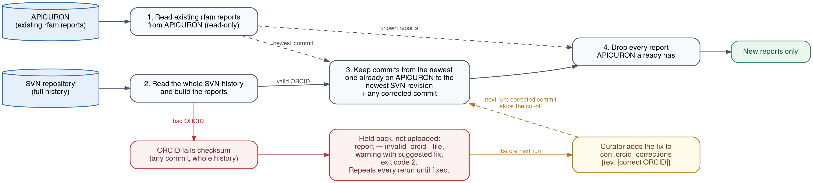

# APICURON submission: SOP

[APICURON](https://apicuron.org) credits curators for their work. Rfam sends it
one report per curation activity, built from the commits in the Rfam SVN
repository by [`scripts/apicuron/bulk_upload.py`](../bulk_upload.py) in the
rfam-production repository.

- [Commit messages](#commit-messages)
- [Prerequisite](#prerequisite)
- [Run upload script](#run-upload-script)
  - [How it works](#how-it-works)
  - [Script parameters](#script-parameters)
  - [Run the script](#run-the-script)
- [Check outputs](#check-outputs)
  - [Files written](#files-written)
  - [Exit codes](#exit-codes)
- [Troubleshooting](#troubleshooting)
  - [Fixing a wrong ORCID](#fixing-a-wrong-orcid)
- [Notes on existing APICURON data](#notes-on-existing-apicuron-data)
- [Tests (for developers)](#tests-for-developers)

## Commit messages

As `bulk_upload.py` assigns the curator by the ORCID in the commit, from
**11 November 2026** every SVN commit should name the curator's ORCID at the
end of the message:

```
<message> by <ORCID>
<message> by <ORCID> and <ORCID>
```

Examples:

```
CI:update GO terms by 0000-0001-8457-4455
CI:fix SS_cons by 0000-0001-8457-4455 and 0000-0002-6497-2883
```

- If a message names several ORCIDs, each curator gets their own APICURON
  report for that commit ("by A and B" gives one report for A and one for B).
- A mistyped ORCID (one that fails the ORCID checksum) is **not uploaded**
  until someone adds a correction (see [Fixing a wrong ORCID](#fixing-a-wrong-orcid)).
  Other, valid ORCIDs in the same message are still uploaded.
- If no ORCID is found in the message, the commit is credited by:
  1. the SVN username, if it is in `curator_orcids` in [`conf.py`](../conf.py);
  2. if the username is `rfamprod`: the main curator (by default Nancy,
     `0000-0001-8457-4455`).

  If neither applies, the commit goes to the `others_` file and is not
  uploaded.

The message's prefix sets the activity. Matching is case-sensitive and looks
anywhere in the message; if several match, the last one in this list wins:

| Message contains | Activity |
|---|---|
| `CI` | `update_family` |
| `NEW` (e.g. `NEWMOV`) | `create_family` |
| `KILL` | `delete_family` |
| `CLCI` | `update_clan` |
| `CLKILL` | `delete_clan` |

A commit is skipped when it has none of these words, or changes no `RFxxxxx`
path.

## Prerequisite

| What | Check with |
|---|---|
| Python 3.8 or newer, with `requests` | `python3 -c "import requests"` |
| The `svn` command | `svn --version --quiet` |
| Read access to the SVN repository | `svn info file:///nfs/production/agb/rfam/SVN_REPOSITORY/data_repos` |
| `PYTHONPATH` set to the repository root | see the commands below |

Configure `config/rfam_local.py` (not in git) with:

```python
APICURON_TOKEN = '...'   # can be found in rfam accounts
BULK_REPORT_URL = 'https://apicuron.org/api/reports/bulk'
```

To credit a new curator by HPC username, add them to `curator_orcids` in
[`conf.py`](../conf.py):

```python
'username': '0000-0000-0000-0000',
```

Run from a working folder. The script writes its files into the current
folder.

```bash
git clone https://github.com/Rfam/rfam-production.git
cd rfam-production
git checkout improve-fasta-export
export PYTHONPATH=.
SCRIPT=$PYTHONPATH/scripts/apicuron/bulk_upload.py
SVN=/nfs/production/agb/rfam/SVN_REPOSITORY/data_repos
```

## Run upload script

### How it works

By default the script works as below:



*Figure 1. `bulk_upload.py` workflow*

1. Read the existing rfam reports from APICURON (read-only).
2. Read the whole SVN history and build the reports: one per curator ORCID,
   for each commit with an activity and an `RFxxxxx` path.
3. Keep the commits from the newest one already on APICURON to the newest SVN
   revision, plus any commit fixed in `conf.orcid_corrections`.
4. Drop every report APICURON already has. What is left is uploaded.

- **Red:** an ORCID that fails its checksum, in any commit. Its report is held
  back in the `invalid_orcid_` file and the run ends with exit code 2. This
  repeats on every run until it is fixed.
- **Yellow:** the curator adds the correct ORCID to `conf.orcid_corrections`.
  On the next run that commit is uploaded, even if it is older than the
  cut-off in step 3.

<a id="same-report"></a>A new report **matches** a report on APICURON when both
have the same `activity_term`, `curator_orcid` and `entity_uri`, and their
timestamps are the same or exactly 1 or 2 whole hours apart (different
timezone).

Adding `--dry-run` writes the files but skips uploading.

### Script parameters

| Option | Default | Use |
|---|---|---|
| `--svn PATH_OR_URL` | (none) | SVN repository path or URL. Required unless `--upload-file` is given |
| `--start REV` | newest SVN commit on APICURON | First revision to read |
| `--end REV` | newest revision + 1 | Revision **after** the last one to read |
| `--dry-run` | off | Write the files, do not upload |
| `--rfamprod-orcid ORCID` | `0000-0001-8457-4455` (Nancy) | Curator for `rfamprod` commits without an ORCID; `''` for none |
| `--upload-file FILE` | | Upload an existing report file instead of reading SVN |
| `--log-file FILE` | `apicuron_upload_<date>_<time>.log` | Where to write the log |
| `--delete-all` | off | **Deletes every rfam report on APICURON** before uploading, including the Google Sheet ones. Needs `--start` or `--upload-file`. Do not use routinely |

### Run the script

Dry run first (nothing is uploaded), then [check the outputs](#check-outputs):

```bash
python3 $SCRIPT --svn $SVN --dry-run
```

Then upload:

```bash
python3 $SCRIPT --svn $SVN
```

The log shows one line per batch (`Batch 1/3 uploaded (… reports)`) and ends
with `Finished`.

## Check outputs

### Files written

| File | Content |
|---|---|
| `bulk_report_svn_<date>.json` | new reports, to be uploaded |
| `others_bulk_report_svn_<date>.json` | commits with no curator (not uploaded) |
| `invalid_orcid_bulk_report_svn_<date>.json` | mistyped ORCIDs, with the revision (not uploaded until corrected) |
| `apicuron_upload_<date>_<time>.log` | what the run did |

### Exit codes

| Code | Meaning |
|---|---|
| `0` | all is well |
| `1` | the run failed |
| `2` | finished, but some ORCIDs need a correction (the valid reports are still uploaded) |

In the log, check these lines:

```
APICURON already has 15149 rfam reports
Newest svn commit on APICURON is r26147; starting there
3 new reports to upload, 1 without a curator (r26147-r26151)
Dry run: nothing uploaded
Finished
```

Then:

- Open `bulk_report_svn_<date>.json` and check that the curators and families
  look right.
- Look at `others_…json`. If a real curator is in it, add their username to
  `conf.py` and run the dry run again.

## Troubleshooting

If the upload fails, **run the same command again**. Reports that reached
APICURON are recognised and skipped, so only the rest is sent. No duplicates
are created.

### The exit code is 1 and the log has the error with a traceback

Common causes:

| Log message | Fix |
|---|---|
| `No APICURON_TOKEN in config` | Add the token to `config/rfam_local.py` |
| `Batch N/M failed: …` (HTTP error) | Read the APICURON message in the log; rerun once fixed |
| `svn … failed: …` | Check the SVN path and access |
| `No svn commit found on APICURON; give --start` | Give `--start <revision>` |
| `No module named 'config'` | Set `PYTHONPATH` to the repository root |
| `conf.orcid_corrections rN: invalid ORCID …` | A correction itself is mistyped; fix it in `conf.py` |

## Fixing a wrong ORCID

Commit messages cannot be edited, so the correct ORCIDs are recorded in
`orcid_corrections` in [`scripts/apicuron/conf.py`](../conf.py). The script
applies them before comparing with APICURON.

### 1. Find the commit in the log

```
WARNING r26160: invalid ORCID 0000-0002-6497-2884 (failed checksum); not uploaded. Fix: add to orcid_corrections in conf.py:
    26160: ['0000-0001-8457-4455', '<correct ORCID>'],  # message had 0000-0002-6497-2884
WARNING 1 commits need an ORCID correction: r26160
```

or in `invalid_orcid_bulk_report_svn_<date>.json` (`revision`, and the wrong
ORCID in `curator_orcid`). Valid ORCIDs from the same message are already in
the suggested line, and already uploaded.

### 2. Get the right ORCID from the curator

### 3. Add the line to `orcid_corrections` in `conf.py`, replacing `<correct ORCID>`

```python
orcid_corrections = {
    26160: ['0000-0001-8457-4455', '0000-0002-6497-2883'],  # message had 0000-0002-6497-2884
}
```

Where:

- Key: the revision number, without `r`.
- Value: **all** ORCIDs of that commit; it replaces the message's ORCIDs.
- An empty list `[]` means: never upload that commit.
- A mistyped ORCID here stops the run before anything is uploaded
  (`conf.orcid_corrections r26160: invalid ORCID …`).

### 4. Double-check and upload

1. Dry run, and check that the warning for that revision is gone, the exit
   code is 0 (`echo $?`), and `bulk_report_svn_<date>.json` has the commit
   with the right ORCID (unless it is already on APICURON).
2. Upload as usual. A corrected commit is read even if it is older than the
   automatic start; reports already on APICURON are skipped (see Figure 1).
3. Commit `conf.py` to git. Without the correction, later runs see the wrong
   ORCID again and keep warning.

Prefer not to upload corrections separately. Add the correction and run the
script; it uses the commit's own time, family and activity. If you must upload
separately with `--upload-file`, use exactly the SVN commit time in UTC (e.g.
`2026-11-20T09:00:00Z`), the same `activity_term` and `entity_uri` (see
[below](#uploading-a-report-file-separately)). Otherwise the next run does not
recognise it and uploads it again.

### What the next run does for each problematic entry

| Right report already on APICURON ([match](#same-report))? | Correction in `conf.py`? | Next run |
|---|---|---|
| Yes | Yes | Not uploaded, no warning |
| Yes | No | Not uploaded, **warning every run** |
| No (or a different time) | Yes | **Uploaded** (a duplicate if a different-time copy exists) |
| No | No | Not uploaded, **warning every run** |

The script only adds reports; it never deletes or changes them on APICURON,
unless `--delete-all` is given.

### Uploading a report file separately

Use this only when a report cannot come from a normal run. The file uses the
same format as `bulk_report_svn_<date>.json`:

```json
{
    "resource_id": "rfam",
    "reports": [
        {
            "activity_term": "update_family",
            "curator_orcid": "0000-0002-6497-2883",
            "entity_uri": "https://rfam.org/family/RF00001",
            "timestamp": "2026-11-20T09:00:00Z"
        }
    ]
}
```

For an SVN commit, take the time and family from the commit itself:

```bash
svn log -v -r 26160 --xml $SVN | grep -E '<date>|RF[0-9]{5}'
#   <date>2026-11-20T09:00:00.412345Z</date>  →  "2026-11-20T09:00:00Z"
```

With `--upload-file` the script does **not** check ORCIDs, apply corrections
or use the cut-off, so check every ORCID first:

```bash
python3 -c "from scripts.apicuron.bulk_upload import is_valid_orcid as v; print(v('0000-0002-6497-2883'))"
```

Then upload (reports APICURON already has are still skipped):

```bash
python3 $SCRIPT --upload-file my_reports.json
```

Do not upload the `invalid_orcid_` or `others_` files.

## Notes on existing APICURON data

- Reports uploaded in **2023** have times 1 hour too early: UK time was sent
  without a timezone and read as Italian time. When checking for existing
  reports, the script treats a whole-hour difference of up to 2 hours
  (`TIMEZONE_TOLERANCE_HOURS`) as the same report.
- Many 2023 reports came from the Google Sheet (`extract_sheets_info.py`) with
  **random** timestamps, so they do not match any SVN commit. The script leaves
  them alone.
- Uploads since November 2026 use the correct UTC time (ending in `Z`).
- The Nextflow workflow (`release/workflows/apicuron/main.nf`) **uploads** (no
  `--dry-run`) and passes fixed `--start`/`--end` from
  `release/nextflow.config`, so new commits are missed until those values are
  updated.

## Tests (for developers)

Run the tests before committing any change to `bulk_upload.py` or `conf.py`:

```bash
cd /path/to/rfam-production      # must be the repository root
python3 -m unittest scripts.apicuron.tests.test_bulk_upload -v
```

All 46 tests should pass (`OK`) in under a second.

The tests can be run anywhere, at any time:

- **No token or `rfam_local.py`:** a fake `config.rfam_config` is used.
- **No SVN:** the script is given fake commits instead of running `svn`.
- **No network, nothing uploaded:** `requests.get` and `requests.post` are
  replaced with fakes.
- **No files left behind:** each test runs in an empty temporary folder.

### What is covered

| Test class | Covers |
|---|---|
| `TestOrcids` | ORCID checksum, finding ORCIDs in a message, bad entries in `orcid_corrections` |
| `TestParsing` | UTC timestamps, family URI, `svn log` parsing and errors |
| `TestHeader` | API token header |
| `TestRemoveExisting` | matching reports APICURON already has (exact time, whole-hour shifts) |
| `TestWriteReport` | curator priority, held-back bad ORCIDs, corrections, the automatic start and end |
| `TestCorrectionPushedSeparately` | a correct ORCID uploaded to APICURON outside the script |
| `TestSnapshot` | the full content of the three output files (see below) |
| `TestUpload` | batching by size, `--delete-all` on the first batch only, rerun after a failed batch |
| `TestExistingReports` | downloading the existing reports, stopping on an incomplete download |
| `TestCommandLine` | argument checks (e.g. `--delete-all` needs `--start`) |
| `TestMain` | exit codes 0, 1 and 2 |
| `TestLogging` | the log file |

### Snapshot files

`TestSnapshot` builds the three output files from a fixed set of fake commits
and compares them in full with:

- `scripts/apicuron/tests/data/expected_bulk_report.json`
- `scripts/apicuron/tests/data/expected_others_bulk_report.json`
- `scripts/apicuron/tests/data/expected_invalid_orcid_bulk_report.json`

If this test fails, check whether the output changed by mistake. Only if you
changed the output **on purpose**, update these files by hand and check the
diff before committing.

### Adding a test

- Build fake commits with `revision(rev, author, date, message, paths)` and
  fake APICURON reports with `report(timestamp, orcid, term, uri)`.
- For `write_report`, subclass `WriteHelper` and call
  `self.write(revisions, existing=..., corrections=..., start=...)`. It
  returns the upload and `others_` reports, and sets `self.invalid` and
  `self.warnings`.
- Never call the real APICURON from a test. Patch `requests` as `TestUpload`
  does.

### Before a real upload

After the tests pass, do a [dry run](#run-the-script) on the real repository.
It reads APICURON (needs the token) and uploads nothing.
